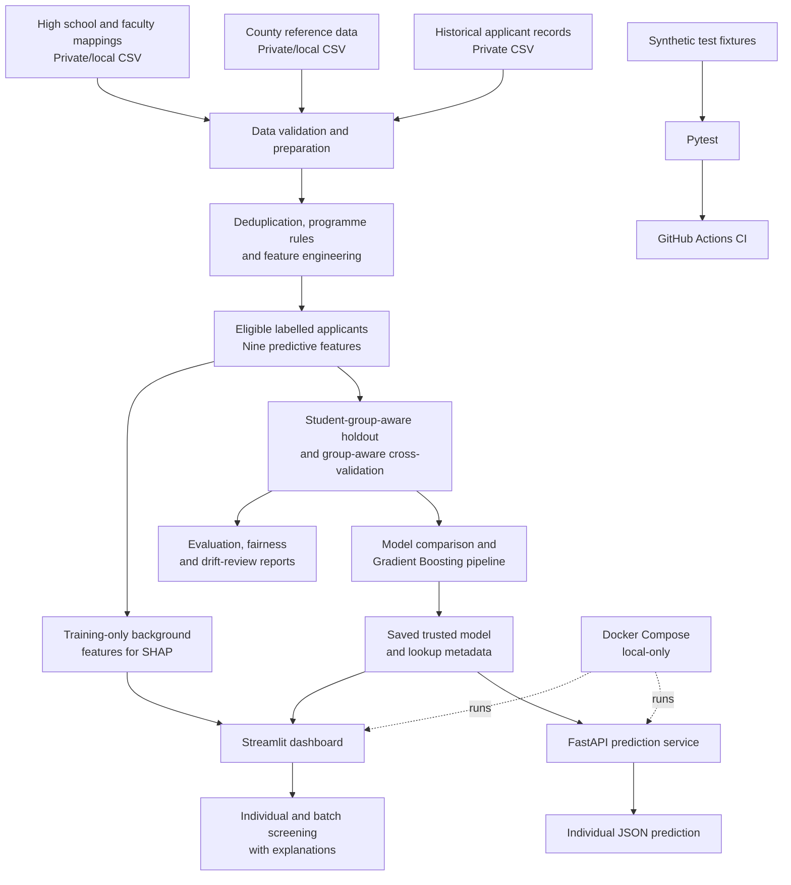

# Scholarship Capstone Project

## Machine Learning–Based Decision Support for Scholarship Applicant Shortlisting

This project develops an **explainable, reproducible machine learning prototype** to support scholarship applicant screening at the **Strathmore University Financial Aid Office (FAO)**. It uses historical scholarship application outcomes (`Approved` / `Not Approved`) to investigate whether structured applicant information can help reviewers prioritise applications consistently.

The project combines a data-preparation pipeline, comparative machine learning experiments, a **Gradient Boosting** prediction pipeline, **SHAP** explanations, a **FastAPI** service, a **Streamlit** dashboard, local **Docker Compose** deployment, and automated tests using **GitHub Actions**.

> **Research and decision-support only.** A predicted historical approval outcome is **not** proof of financial need, scholarship eligibility, or entitlement to funding. The system must not automatically approve or reject applicants. Authorised staff must review every substantive decision.

## 1. Problem overview and objectives

Scholarship shortlisting traditionally involves manual review of applicant records in spreadsheets. This can become time-consuming as application volumes grow, and decisions may vary across reviewers. The project investigates how predictive analytics can assist without replacing human judgement.

**Objectives**

1. Prepare and validate historical scholarship application records and institutional reference mappings.
2. Engineer interpretable predictors from academic history, geographic context, school category, application timing, and parent status.
3. Compare classification approaches and implement a reproducible Gradient Boosting pipeline.
4. Reduce leakage by separating records for the same student during validation.
5. Explain individual predictions with SHAP and examine subgroup outcomes and feature-distribution shifts.
6. Offer individual and batch scoring through local API and dashboard interfaces.
7. Verify critical behaviour with synthetic-data tests executed locally and in GitHub Actions.

## 2. Architecture



**Architecture notes:** The Streamlit dashboard and FastAPI service load the same trusted model artifact independently; the dashboard does not depend on calling the API. Model files and private training data are generated or stored locally, not downloaded from GitHub Actions. Docker services are intended for local evaluation, not public production deployment.

## 3. Data inputs and predictive features

### Required local input files

Place the following files in `data/` **only if you have authorisation to use them**:

| File | Purpose |
| --- | --- |
| `fa_final.csv` | Historical scholarship applicant records and outcome labels for the current v3 workflow |
| `County_GVA_Contribution_Ranked_2019_2023.csv` | County reference mapping |
| `school_classifications.csv` | High-school classification mapping |
| `su_faculty.csv` | University course-to-school mapping for reporting |

Earlier iterations used `fao_2021_2026_applicants_cleaned.csv`; do not interchange it with `fa_final.csv` without checking deduplication, eligibility and status rules. The precise columns and valid values are checked by `src/data_pipeline.py`. Do not replace these files with differently structured datasets without validating the pipeline and mappings.

### Model inputs

The current v3 model uses **nine predictive features**:

| Numerical features | Categorical features |
| --- | --- |
| `O LEVEL YEAR` | `Parent Status` |
| `Apply_Year` | `High School Category` |
| `County Rate` | |
| `mean_grade_score` | |
| `high_school_category_score` | |
| `o_level_apply_score` | |
| `parent_status_score` | |

Two particularly important distinctions:

- **University School** (for example, SBS or SIMT) is retained for display and reporting but **is not a model predictor or SHAP feature**. **High School Category** is a different variable and remains a predictor.
- **Programme eligibility** is evaluated as a separate rule before scoring. Supported undergraduate degrees, diplomas, and CPA programmes are treated as eligible under the current project policy; clearly ineligible programmes are not scored, and unrecognised programmes require manual review. `programme_eligible` is **not included** among the nine model features.

Student identifiers help enforce group separation during validation but are not predictive inputs. The label is the **recorded historical application status**, rather than an independently verified measure of need.

## 4. Modelling, evaluation and interpretation

The research investigates **Logistic Regression, Random Forest, XGBoost, and Gradient Boosting**. The deployed **v3 estimator is Gradient Boosting**, with the same feature engineering and preprocessing used in the research notebook and the saved model pipeline.

### Validated data split

Validation uses a student-group-aware holdout split with **no overlap in student IDs** between development and holdout data. Five-fold group-aware cross-validation is performed on the development portion only. This reduces the risk of information leakage between repeat applications from the same student.

| Validation measure | Verified count |
| --- | ---: |
| Eligible applicant records | 2,241 |
| Development records | 1,792 |
| Holdout records | 449 |
| Unique development students | 1,685 |
| Unique holdout students | 424 |
| Student IDs appearing in both sets | **0** |

Source: `artifacts/split_summary.json` from the verified v3 run.

### Final model comparison — held-out evaluation

The following results are from the **final, feature-aligned notebook run** comparing four classification models on the scholarship application outcome (`Approved` = positive class). The final Gradient Boosting row also matches the recorded `artifacts/holdout_metrics.json` values to four decimal places. Metrics for the other three models are reported from the notebook output; do not substitute scores from earlier experiments.

| Model | Accuracy | Precision | Recall | F1-score | ROC-AUC |
| --- | ---: | ---: | ---: | ---: | ---: |
| Logistic Regression | 0.5991 | 0.6125 | 0.7778 | 0.6853 | 0.6127 |
| Random Forest | 0.5924 | 0.6228 | 0.6944 | 0.6567 | 0.6197 |
| XGBoost | **0.6147** | **0.6447** | 0.6984 | 0.6705 | 0.6123 |
| **Gradient Boosting (deployed v3)** | **0.6147** | 0.6215 | **0.8016** | **0.7002** | **0.6455** |

**Interpretation:** Gradient Boosting achieved the highest ROC-AUC, recall and F1-score of the four models. XGBoost obtained the highest precision and tied Gradient Boosting on accuracy. These results demonstrate **modest predictive discrimination**, not evidence that the models can independently determine scholarship eligibility or financial need. The final Gradient Boosting model is used as an aid for **human review**, not an automatic award decision.

### Verified Gradient Boosting holdout results

These are the **final reported v3 holdout metrics**, reproduced to four decimal places in the corrected notebook and recorded in `artifacts/holdout_metrics.json`.

| Evaluation metric | Gradient Boosting |
| --- | ---: |
| **Accuracy** | **0.6147 (61.47%)** |
| **Precision** | **0.6215 (62.15%)** |
| **Recall** | **0.8016 (80.16%)** |
| **F1-score** | **0.7002** |
| **ROC-AUC** | **0.6455** |
| Precision among 50 highest-scored cases | 0.6600 (66.00%) |

**Confusion matrix** (evaluated at the reported classification threshold):

| Actual historical outcome | Predicted Not Approved | Predicted Approved |
| --- | ---: | ---: |
| Not Approved | 74 | 123 |
| Approved | 50 | 202 |

The model identified **202 of 252 historically approved applications** in the holdout, while 50 were missed. It also predicted approval for **123 of 197 historically not-approved applications**. These figures demonstrate meaningful limitations: the predictions describe patterns in past decisions and **must not** be interpreted as independent evidence of financial need or eligibility.

> **Version consistency:** These comparison results supersede the older exploratory figures (including the previously reported Gradient Boosting ROC-AUC of `0.6314`). Use the latest feature-aligned notebook results and the matching v3 holdout artifacts when reporting final performance; do not mix metrics from earlier dataset, preprocessing or validation versions.

**Explainability:** SHAP describes how the trained model's features contribute to an individual predicted probability. SHAP is an explanation of model behaviour, **not a causal statement** about an applicant's eligibility or circumstances.

**Monitoring and fairness:** The project reviews historical subgroup error rates and compares development/holdout feature distributions using measures such as PSI and total variation distance. Subgroup differences warrant further review; a historical holdout comparison does **not** establish stability or fairness for future applicant cohorts.

## 5. Project structure

```text
Scholarship Project/
├── .github/workflows/tests.yml   # GitHub Actions automated tests
├── .streamlit/config.toml        # Dashboard configuration
├── data/                         # PRIVATE source/reference data (local only)
├── artifacts/                    # Locally generated model, metrics and SHAP outputs
├── notebooks/
│   └── fao_project.ipynb         # Research, EDA and modelling workflow
├── examples/                     # Review examples before sharing publicly
├── src/
│   ├── data_pipeline.py          # Validation, policy rules and features
│   ├── train.py                  # Training, grouped validation, evaluation
│   ├── api.py                    # FastAPI endpoints
│   └── dashboard_service.py      # Dashboard scoring and SHAP logic
├── tests/
│   ├── test_data_pipeline.py     # Feature-engineering unit tests
│   └── test_v3_integration.py    # Synthetic model, SHAP and API tests
├── dashboard.py                  # Streamlit interface
├── explain_shap.py               # Offline SHAP report generation
├── Dockerfile.fao                # Docker image definition
├── compose.fao.yaml              # Local API + dashboard services
├── docker.env.example            # Example Docker build configuration
├── requirements.txt             # Backend/model dependencies
├── requirements_dashboard.txt   # Dashboard dependencies
├── AI_USE.md                     # AI assistance disclosure
└── README.md
```

## 6. Setup: local Python environment

**Prerequisites:** Python **3.12**, Git, and (for the Docker option) Docker Desktop running Linux containers. Commands below are for **PowerShell** from the project root.

```powershell
# Clone only if you are authorised to access the repository and its contents.
git clone https://github.com/JulienNgalo/Scholarship_capstone_project.git
Set-Location Scholarship_capstone_project

# Set up the environment.
python -m venv .venv
.\.venv\Scripts\Activate.ps1
python -m pip install --upgrade pip
python -m pip install -r requirements.txt
python -m pip install -r requirements_dashboard.txt
python -m pip install pytest
```

For macOS/Linux, activate the virtual environment using `source .venv/bin/activate` instead.

> A public, safe-to-share copy of institutional training data and generated model artifacts is **not provided**. An authorised reviewer needs access to the required local source files to reproduce real-data training. The automated tests do **not** require those files. Files from older commits may still be reachable in Git history and require separate privacy review.

## 7. Reproduce the pipeline and model

**Step 1 — Supply authorised data.** Place the four input CSV files from Section 3 inside `data/`. Confirm filenames, column names, permission to process the records, and reference mapping quality.

**Step 2 — Run data preparation and validation.**

```powershell
python -m src.data_pipeline
```

**Step 3 — Train the current model from the intended input source.**

```powershell
python -m src.train --applicants data/fa_final.csv
```

The training procedure generates or refreshes local files such as:

- `artifacts/scholarship_model.joblib` — versioned trained pipeline and mappings.
- `artifacts/holdout_metrics.json` — held-out evaluation results.
- `artifacts/group_cv_folds.csv` and `artifacts/group_cv_summary.csv` — grouped cross-validation records.
- `artifacts/split_summary.json` and `artifacts/data_audit.json` — validation and cleaning summaries.
- `artifacts/training_data.csv` — **development/training-only feature background** used by SHAP, not the reserved holdout set.

File availability can depend on the code version and whether the relevant generation step completed. **Use metrics from the artifacts generated by the same model run**; do not mix reports from earlier notebook experiments with current v3 holdout results. The verified results in Section 4 use `artifacts/holdout_metrics.json` and `artifacts/split_summary.json`; running training again may generate different results if inputs, code, package versions, or parameters have changed.

**Step 4 — Create offline SHAP outputs (optional).**

```powershell
python explain_shap.py
```

Inspect outputs under `artifacts/shap/` locally. They may include sensitive record-level explanations and should not be publicly committed.

## 8. Run the application without Docker

**Start FastAPI** in one PowerShell terminal:

```powershell
python -m uvicorn src.api:app --reload --port 8001
```

Useful local URLs:

- `http://127.0.0.1:8001/docs` — interactive Swagger API documentation.
- `http://127.0.0.1:8001/health` — model readiness.
- `http://127.0.0.1:8001/model-info` — schema and model metadata.

**Start Streamlit** in a second PowerShell terminal (with the same environment active):

```powershell
python -m streamlit run dashboard.py
```

Open `http://localhost:8501` for individual applicant screening, batch CSV scoring and SHAP explanations. Use fictional or appropriately authorised data for demonstrations.

### Example API request (fictional applicant)

The `/predict` endpoint accepts applicant attributes including the course, used for independent programme-eligibility screening.

```powershell
$body = @{
    mean_grade = "B+"
    o_level_year = 2023
    county = "Nairobi"
    date_applied = "2026-11-18T10:00:00"
    high_school = "Alliance High School"
    parent_status = "Both Parents"
    course = "Bachelor of Commerce"
} | ConvertTo-Json

Invoke-RestMethod -Uri "http://127.0.0.1:8001/predict" `
    -Method Post -ContentType "application/json" -Body $body
```

This is a synthetic demonstration record, not an institutional applicant record. Actual scoring requires the locally trained trusted model and matching reference data.

## 9. Run with Docker Compose (local-only)

The v3 Docker setup uses **`compose.fao.yaml`**, rather than relying on the older default `docker-compose.yml`. Both dashboard and API mount the same local `artifacts/` directory read-only.

**Step 1 — Verify local artifacts and Docker:**

```powershell
docker --version
docker compose version
Test-Path .\artifacts\scholarship_model.joblib
Test-Path .\artifacts\training_data.csv
```

Both `Test-Path` checks should return `True`.

**Step 2 — Align the Docker scikit-learn build version with the version used to train the model:**

```powershell
$sklearnVersion = python -c "import sklearn; print(sklearn.__version__)"
"SCIKIT_LEARN_VERSION=$sklearnVersion" | Set-Content -Encoding ascii docker.env.local
```

Keep `docker.env.local` out of Git. Model artifacts serialized with `joblib` should be loaded only from trusted sources, using a compatible Python and scikit-learn environment.

**Step 3 — Launch both services:**

```powershell
docker compose --env-file docker.env.local -f compose.fao.yaml config
docker compose --env-file docker.env.local -f compose.fao.yaml up -d --build
docker compose -f compose.fao.yaml ps
```

Open `http://localhost:8501` for Streamlit or `http://localhost:8001/docs` for FastAPI. Services are intended to bind to `127.0.0.1`, not public interfaces.

**Stop services:**

```powershell
docker compose -f compose.fao.yaml down
```

## 10. Run tests and verify Continuous Integration

The tests use **generated synthetic applicant data and temporary model artifacts**, rather than institutional records.

**Run all six tests locally:**

```powershell
python -m pytest tests/ -v
```

The verified local run completed with **6 passed, 1 non-blocking deprecation warning**. The corresponding GitHub-hosted workflow also completed with **6 passed, 1 warning** on Ubuntu/Python 3.12. The current warning concerns `httpx`/Starlette test-client compatibility and does not fail the tests.

The workflow is defined at `.github/workflows/tests.yml` and runs on **push**, **pull request**, or supported manual invocation. See the repository **Actions** tab for job logs and reproducibility evidence. This pipeline demonstrates **continuous integration (CI)**; it does **not** deploy the application automatically.

## 11. Limitations, governance and responsible use

- **Outcome is historical approval, not ground-truth need.** Models may learn past selection practices and inconsistencies.
- **Generalisation is unverified for future cohorts.** Group-aware holdout testing does not replace prospective validation.
- **Fairness must be evaluated continuously.** Subgroup samples can be small, and observed error gaps do not establish causality.
- **Explainability is descriptive.** SHAP explanations show predictive contributions, not reasons why an applicant deserves or does not deserve financial aid.
- **Sensitive data require institutional controls.** Keep identifiable applicant records, local trained artifacts, notebooks with sensitive outputs, and exports out of public repositories.
- **Local prototype is not production-ready.** Authentication, authorisation, HTTPS, audit logs, retention controls, monitoring, security reviews and an appeals process would be required for operational use.

**Git history caution:** Removing sensitive files from the latest commit or adding `.gitignore` entries does **not** remove previously committed copies from history. This repository should remain **private** until its entire reachable history has undergone authorised privacy review and remediation. Grant the lecturer authorised private access rather than temporarily exposing institutional applicant records publicly.

## 12. Research reproducibility checklist

- [ ] Use the intended v3 code revision and Python 3.12 environment.
- [ ] Obtain authorised access to the source/reference CSVs and validate their schemas.
- [ ] Execute data preparation and retrain the model using the supplied training command.
- [ ] Record `artifacts/holdout_metrics.json`, grouped CV output and data-audit results from **that** run.
- [ ] Confirm there is no shared student ID between training and held-out groups.
- [ ] Run SHAP generation and review individual explanations in a controlled environment.
- [ ] Start the API/dashboard locally or through Docker Compose and try synthetic records.
- [ ] Confirm `python -m pytest tests/ -v` passes and check the GitHub Actions logs.
- [ ] Review privacy, ethics and fairness limitations before any wider dissemination.

## Acknowledgement

See `AI_USE.md` for disclosure of AI-assisted development and documentation where applicable.
